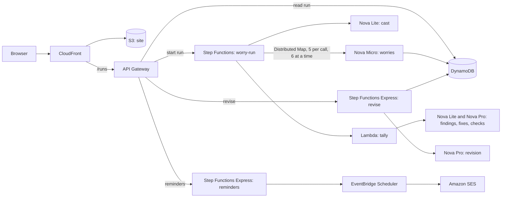

# 1,000 Worriers

*They worry, so you don't.*

**Live demo:** https://dydffb4pxxqqw.cloudfront.net

1,000 Worriers runs a pre-mortem on any plan you type. Up to a thousand AI perspectives each read the plan from one angle and imagine one way it could fail. The app groups what they raised, shows the words of your plan each concern depends on, suggests changes, lets you decide, and then checks your amended plan again.

It runs entirely on serverless AWS and deploys with one command.

## Why it is useful

When you write a plan alone, you can only imagine the problems you already know about. A pre-mortem asks you to picture the plan after it has failed and work out why, and it works best with many people who see the plan differently. Most plans go ahead without that room: a database migration written late on a Thursday, a surprise party, a product launch, a family trip.

1,000 Worriers gives you that room in a few minutes, for a few cents. You leave with:

- the concerns your plan overlooks, each tied to the exact words of your plan it depends on
- the people your plan affects and the questions worth asking them
- one concrete change per concern, with a check you can observe
- your plan with the changes you accepted, kept apart from the questions you still need to answer
- a re-test that shows which concerns your changes address and which stay open

### An example from a real run

A database migration plan said: "Writes are paused via a feature flag." The worriers raised a gap: the plan did not say how anyone would know the flag works. The app proposed "Verify feature flag functionality with test writes" with the check "Confirm test writes are paused". After that change was accepted, the re-test marked the concern **partly addressed**: the test was in the plan, and nobody had run it yet.

For a surprise proposal, the plan covered the ring, twelve friends with candles and a friend filming. The app asked two questions the plan had not settled: "Does she prefer a private proposal?" and "Does she want the proposal recorded?"

## How it works

1. **Cast.** Amazon Nova Lite reads your plan and builds a cast: the people involved, up to 3 characters per group, 11 angles that could fail plus the angle "what the people affected actually want", and 5 moments in time.
2. **Swarm.** Each worrier is one character, one angle and one moment. Amazon Nova Micro writes one specific failure for each, with the plan words it depends on, what the plan leaves out, a severity and an early warning sign. A full run holds up to 1,000 worriers; a smaller cast gives fewer.
3. **Grounding.** Code checks each quoted phrase word for word against your plan and marks quotes that are not in it.
4. **Grouping.** Code screens out generic and duplicate worries and groups the rest by wording (TF-IDF and clustering in numpy). A group's size counts similar worries; the app does not present it as agreement or probability.
5. **Findings.** For each top group, Nova Lite writes a finding: the failure, how it happens, the plan words it depends on and one question. Amazon Nova Pro checks that the finding represents its group and needs nothing your plan leaves out. A finding that does not represent its group goes to "needs your review"; an unsupported one is set aside with the reason.
6. **Fixes.** Nova Lite reads the plan's goal (for example, keeping a surprise). Nova Pro writes candidate fixes, and a Nova Pro critic rejects fixes that miss their finding, give up the goal or repeat what the plan already says. A spotlight shows the people affected as questions, without counts.
7. **Decide.** For each finding you choose: already handled (recorded as your word), needs this fix, or find out first.
8. **Revision.** A workflow saves one revision: your original lines word for word, an exact replacement only where a change alters a number or time, the accepted changes (proposed, not done), open questions and your unverified reports.
9. **Re-test.** The same perspectives read exactly that saved revision. Each finding comes back addressed or partly addressed by a proposed change, check planned with the outcome unknown, reported by you, or still open.
10. **Reminders.** Early warning signs can become one-time emails through EventBridge Scheduler and Amazon SES.

## Architecture



- **CloudFront and S3** serve the page. **API Gateway** calls Step Functions and DynamoDB directly, with no Lambda in front.
- **Step Functions** runs the swarm with a Distributed Map that batches five worriers per Nova Micro call and runs six calls at a time, which keeps a 1,000-worrier run within a 200 requests per minute quota.
- **One Lambda function** (`functions/tally`) groups the worries in code and calls Nova Lite and Nova Pro for findings, fixes and checks.
- **Guards:** at most 1,000 worriers per run, about 100 runs per day through an API usage plan, and an AWS Budgets alert at $5. The alert notifies you; it does not cap spend.

## Deploy it in your AWS account

### Requirements

- An AWS account with access to Amazon Bedrock in `us-east-1`, and model access enabled for Amazon Nova Micro, Nova Lite and Nova Pro
- [AWS CLI](https://aws.amazon.com/cli/) configured with credentials for that account
- [AWS SAM CLI](https://docs.aws.amazon.com/serverless-application-model/latest/developerguide/install-sam-cli.html)
- Python 3.13 (the tally Lambda runtime)
- An email address verified in Amazon SES (`us-east-1`), for reminders and the budget alert

### Steps

```bash
git clone https://github.com/Felina14/thousand-worriers.git
cd thousand-worriers
cp .env.example .env          # then set ALERT_EMAIL to your SES-verified address
./deploy.sh                   # sam build && sam deploy, then uploads site/ and refreshes CloudFront
```

`deploy.sh` prints the app URL when it finishes. Open it, pick a preset or paste your own plan, choose the crowd size and press **Summon the worriers**.

To remove the stack later, empty its S3 bucket and run `sam delete --stack-name thousand-worriers`.

### Try the interface without AWS

The page has a mock mode that runs in the browser with made-up worries and no AWS calls:

```bash
cd site
python3 -m http.server 8766
# open http://localhost:8766/?mock=100
```

### Run the tests

```bash
cd functions/tally
pip install numpy pytest
python3 -m pytest -q tests
```

The tests stub all Bedrock calls, so they cost nothing.

### When an alarm fires

The stack sends every alarm to one SNS topic. Its email subscription uses `ALARM_EMAIL` from `.env` (or `ALERT_EMAIL` when unset); confirm the subscription email once after the first deploy. One response per alarm:

- **worry-run-failed**: open the failed execution in Step Functions, read the run's META `error`, and rerun the plan once the cause is fixed. Error `RunBusy` with META status `BUSY` means the run queued for the swarm lock for 20 minutes and gave up before calling Nova Micro; check the `lock#swarm` item in the table for a stuck holder.
- **lost-worriers**: a finished run saved fewer worriers than it launched. META splits the loss by cause: `lost_throttle`, `lost_parse`, `lost_partial`, `lost_write` and `lost_other`, with the last error name in `last_fail_error`. Tell users the count shown is lower.
- **tally-fallback**: the v2 tally hit an error (usually Nova throttling) and the run used v1; read the run's `tally_error` and rerun when Bedrock is quiet.
- **tally-errors**: read the Tally Lambda log for the stack trace and fix or redeploy; the run is marked FAILED.
- **tally-throttles**: the account Lambda concurrency limit (10) was hit; space out runs or request a concurrency increase.
- **bedrock-throttles-nova-micro / -nova-lite / -nova-pro**: Nova requests were throttled (retries absorb some); if it repeats, slow new runs or request a quota increase for that model.

### One swarm at a time

Nova Micro allows 200 requests per minute for the whole account, and one swarm keeps 6 requests in flight, which is about that rate. The state machine therefore holds a lease lock (the `lock#swarm` item in DynamoDB) while a run's swarm is running. A second run waits in status `QUEUED` and checks the lock every 10 seconds. It takes the lock over when the lease is more than 15 minutes old or when the execution holding it has stopped. After 20 minutes in the queue it ends `BUSY`. Grid and tally steps run outside the lock.

## Cost and speed

A recorded production run on a database migration plan produced 900 worriers in 209.5 seconds and cost $0.060 in Bedrock inference. Its re-test took 112.9 seconds and cost $0.017. Between runs you pay only for storage; DynamoDB items expire after 30 days.

## Limits

- The worriers are generated perspectives, not people. The app shows possible failures, not probabilities.
- The app rewrites a plan line only for an exact change of a number or time. It flags other contradictions only when Nova Pro names them, and its conflict detection misses some cases.
- Proposed changes are not done. "Addressed" means the written plan now contains an action for that concern, not that the action works.
- Results vary between runs, and a finding can end with "no reliable fix".
- The public demo has no user accounts. Please enter plans without confidential or personal details.

## Repository layout

| Path | What it holds |
|---|---|
| `template.yaml` | The whole stack (SAM) |
| `samconfig.toml`, `deploy.sh` | Deploy settings and the one-command deploy |
| `statemachine/` | Step Functions workflows: `worry-run`, `revise`, `reminders` |
| `functions/tally/` | The tally Lambda: `app.py`, `tally_v2.py`, `grounding.py`, the numpy `worrycore/` package and tests |
| `site/` | The web app (plain HTML, CSS and JavaScript) |

## Licence

MIT, see [LICENSE](LICENSE).
